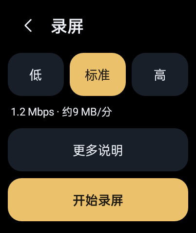

# OWOrnate

**当前预发布：1.0.1-rc9 / versionCode 18。** [下载 v1.0.1-rc9](https://github.com/AUTOlightup/owornate/releases/tag/v1.0.1-rc9)。已在 OPPO Watch 2 / A.92 上同签覆盖安装并完成本轮实机验证，具体范围见 [验证记录](docs/VALIDATION.md)。

OWOrnate（`dev.codex.watchworkshop`）是面向 OPPO Watch 2 的原生 Android 管理器，提供莫奈取色、负一屏小组件、截屏与录屏三个模块。

## 本版变化

- 新截图保存到 `Pictures/Screenshots`，录屏保存到 `Movies/Screenrecords`；旧版本文件保留原位，新文件继续加入系统媒体库。
- 控制中心未录制时直接打开轻量录屏页，后台确认真实会话，减少页面出现前的重复查询和等待。开始录屏仍在设置页退出后执行。
- 三档画质横排，记住上次选择，开始按钮固定在首屏底部；分辨率、保存位置、格式与时长收进“更多说明”。状态变化只更新相关控件，避免整页重建。

## 已有功能

- 原生截屏与录屏：控制中心第二页短按截屏或打开录屏设置，录制中再按停止；长按分别打开 OWOrnate 截屏页、录屏设置页。H.264/MP4、原分辨率、无声、单段最多180秒，码率0.6 / 1.2 / 2.4 Mbps，默认1.2。实际帧率随画面更新变化，不提供固定60fps。
- 模块识别与状态：读取失败保留上次确认值并显示错误；打开管理器与刷新不隐式恢复组件或改白名单。
- 三类负一屏小组件：OWOrnate 信息、倒计时、课表，卡片 181×100dp。每类共用一份设置，在负一屏原生编辑页添加或移除，点卡片再次设置。
- 倒计时支持自己设置或只读接入系统“纪念日”，离开设置页自动保存；课表支持拾光单表 JSON，不支持 ICS、完整备份或通用皮肤导入。
- 可隐藏负一屏顶部小布助手；莫奈的配色方式、固定色和连续圆角实时生效。

## 安装与接入

首次安装和本机 root ADB 授权需用 Windows 包运行 `00-Setup.cmd`；安装包不负责获取 root。已有授权的用户可用电脑同签覆盖安装新 APK，保留数据；已接入 v12 的用户更新后可直接使用，本次改动无需重新接入。尚未接入的模块从管理器对应模块页安装。安装步骤见 [INSTALL.md](docs/INSTALL.md)。

共享接入识别已知 Hook v9/v10/v11/v12 与 helper v6，备份并更新到 v12，定向重载一次 Launcher。小组件与捕获模块仅适配已知共享宿主环境；独立莫奈仍可使用。没有在线模块目录或应用内自动更新。

## 验证范围

code18 已同签装表，原表完成首屏布局、画质记忆、更多说明及返回、退出设置后开始、录制中打开设置、手动停止、新目录及媒体库索引的定向验证；19.03秒402×476 H.264 MP4解码通过，结束后服务与亮屏锁释放。原生捕获模拟14/14、控制中心桥接6/6、完整构建和签名检查通过。180秒到时等历史证据属于code17，本版未重复；详见 [验证记录](docs/VALIDATION.md)。

第三方应用采集、三档画质与高运动帧率比较、长期功耗、锁屏/MCU/轻智能及整机重启恢复仍待验证。纪念日与旧小组件完整交互未由本轮重新验收，历史记录不能替代本版结论。详见 [ACCEPTANCE.md](docs/ACCEPTANCE.md)。

## 隐私与源码

截图保存到 `Pictures/Screenshots`，视频保存到 `Movies/Screenrecords`，只保存在手表本地。发布包不含签名私钥、口令、ADB 私钥、个人课表或设备备份。详见 [隐私说明](docs/PRIVACY.md)、[源码与打包](docs/SOURCE.md) 和 [许可证](docs/THIRD-PARTY.md)。
