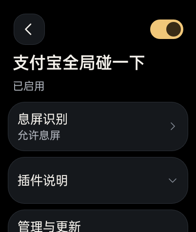
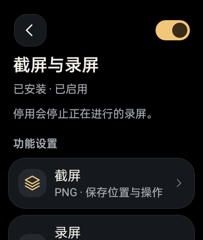
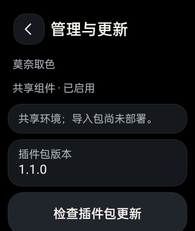

# OWOrnate

**1.0.1-rc29 / code38** · [下载与完整附件](https://github.com/AUTOlightup/owornate/releases/tag/v1.0.1-rc29)

OWOrnate（`dev.codex.watchworkshop`）是面向 OPPO Watch 2 的原生 Android 插件管理器，支持 `.owo` 本地导入、声明式设置和主动检查更新。

插件详情改为设置优先，长说明、管理更新与技术资料同页折叠。莫奈、负一屏小组件和截屏录屏从首页、发现及本地插件列表直接进入完整设置；插件包页只负责包信息、更新和移除，原设置页保留重新接入与修复。新增独立的支付宝全局碰一下插件，支持从表盘或息屏碰标签唤起原支付宝，并有短震动反馈。

  

## 安装

适配基线：OPPO Watch 2 46mm / OW20W1 / A.92 / Android 8.1 API27 / 已有 root。Windows 包不负责获取 root。

1. 首次使用，完整解压 `OWOrnate-v1.0.1-rc29-Windows.zip` 并运行 `00-Setup.cmd`，安装管理器、建立 root ADB 授权和基础环境。已有授权用户可同签覆盖 APK，保留应用数据。
2. 把所需 `.owo` 放到手表 `Download`，从“发现优化 → 本地插件”导入并确认信任。Setup 不自动导入或部署功能插件。
3. 打开相应设置页，安装、接入或启用功能。管理与更新位于同页折叠区域。

详细步骤见 [安装说明](INSTALL.md)。

## 插件

| 插件 | 版本 | 功能 |
| --- | --- | --- |
| `monet-1.1.0.owo` | code2 | 控制中心取色、固定颜色和连续圆角 |
| `widgets-1.0.0.owo` | code1 | 负一屏信息卡片、倒计时与课表 |
| `capture-1.1.0.owo` | code2 | 原生截图、H.264 无声录屏，单段最多 180 秒 |
| `alipay-global-0.1.0.owo` | code1 | 全局碰一下，支持息屏识别、80ms 短震动 |

碰一下还需要自行安装并登录 **OPPO 渠道支付宝 10.6.41.260917 / code3152**，以及 Frida 16.7.19 注入运行环境。发布包不含支付宝 APK。开启后即可碰标签，由原支付宝完成金额输入和支付确认；开机或 NFC 进程重启后需重新开启。见 [碰一下安装与使用](ALIPAY-GLOBAL.md)。

倒计时可只读接入系统“纪念日”，课表支持拾光单表 JSON。开发支持 `shell-v1` 和 `launcher-v1`，见 [快速开始](PLUGIN-QUICKSTART.md)、[本地插件开发](PLUGIN-DEVELOPMENT.md) 和 [Launcher 插件](LAUNCHER-PLUGINS.md)。

自有 Launcher 运行环境 v4 支持多个 Hook；共享 WatchHide 环境保留限制，不部署第三方 Launcher Hook 或替换共享载荷。碰一下使用独立 NFC 进程。插件需要用户信任，没有沙箱隔离；暂不提供第三方原生 Activity、服务或自定义设置页 SDK。

## 更新与验证

“设置 → 管理器更新”检查管理器版本，插件从“管理与更新”检查。清单包含管理器 code38 和上表四个插件，下载后校验 ID、版本和 SHA-256；管理器还检查包名及原签名，经用户确认后交系统安装器。见 [更新协议](UPDATES.md)。

管理器 code38 已在 OW20W1 / A.92 / API27 / root 生产表同签覆盖，设备 APK 与最终产物一致。实机验证三个官方功能与支付宝的入口、返回、折叠管理与恢复动作；临时同版本包模拟更新交接并取消，未执行真实升级。15 项管理测试、62 项资源／assets 一致性及 19 项生产状态与恢复检查通过。code37 已完成正常与 125% 字体下的代表详情页检查；本版沿用相关公共排版。实际小组件界面、共享 Hook 和已有配置保留，临时显示设置恢复，未重启或重载。

支付宝插件已完成导入、启停、配置、卸载重导入与 NFC 服务重启后的手动冷启动；真正息屏下碰贴纸自动唤醒、打开原支付宝并短震动已实测，钱包一张模拟卡的信息读取与标签发现可共存。用户反馈于 2026-10-27 22:23（UTC+8）外出碰一碰付款成功，并提供付款成功照片；这是用户现场实测结果，本轮不另行发起交易或用日志替代付款凭证。

开机或 NFC 进程重启后需手动重新开启碰一下。带屏蓝环、锁屏、轻智能、长期功耗、真实门禁闸机仍未验收。code38 未重新验收联网更新／系统安装器完整升级、实际录屏或所有设置写入；历史通过项按对应版本和前提沿用。

详见 [验证记录](VALIDATION.md) 和 [验收范围](ACCEPTANCE.md)。

## 隐私与源码

插件不修改原支付宝账号、支付请求、金额或支付确认，保留钱包 SE/AID 路由。没有遥测、后台定时更新或静默安装；发布包不含付款照片、账号数据、设备备份、签名或 ADB 私钥。见 [隐私说明](PRIVACY.md)、[源码与打包](SOURCE.md)、[第三方组件](THIRD-PARTY.md)。
