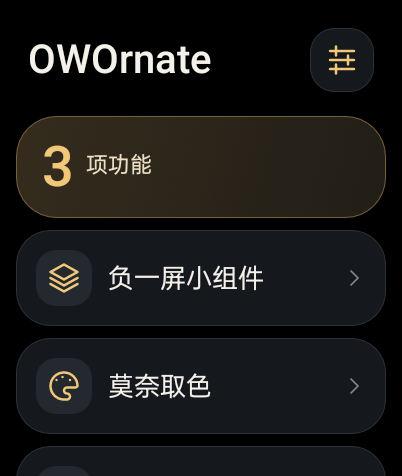
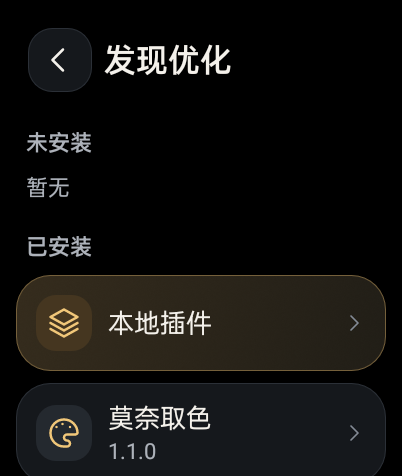
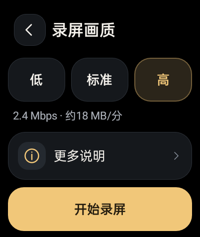

# OWOrnate

**1.0.1-rc27 / code36** · [下载与完整附件](https://github.com/AUTOlightup/owornate/releases/tag/v1.0.1-rc27)

OWOrnate（`dev.codex.watchworkshop`）是面向 OPPO Watch 2 的原生 Android 插件管理器。提供统一管理页、右上开关、`.owo` 导入、声明式设置与主动检查更新；莫奈取色、负一屏小组件和截屏录屏分别作为插件管理。

本版统一管理器界面，精简主页与导航文案，发现页在同一界面按“未安装／已安装”分组，本地插件位于已安装首位。已安装条目显示实际版本；小组件设置、课表与录屏画质页使用统一样式。实际负一屏小组件的布局与配色保持。

  

## 安装

适配基线为 OPPO Watch 2 46mm / OW20W1 / A.92 / Android 8.1 API27 / 已有 root。Windows 包不负责获取 root。

1. 首次使用，完整解压 `OWOrnate-v1.0.1-rc27-Windows.zip`，运行 `00-Setup.cmd` 安装管理器、建立本机 root ADB 授权并准备基础环境。
2. 将所需 `.owo` 放到手表 `Download`，从“发现优化 → 本地插件”导入并确认信任。Setup 不会替你复制、导入或部署功能插件。
3. 在统一管理页安装、接入或启用对应功能。已有授权用户可同签覆盖 APK，保留应用数据。

详细步骤见 [安装说明](INSTALL.md)。下载文件、Windows 完整包、源码和校验清单均在发布页提供。

## 插件与功能

| 插件 | 版本 | 功能 |
| --- | --- | --- |
| `monet-1.1.0.owo` | code2 | 控制中心取色、固定颜色和连续圆角 |
| `widgets-1.0.0.owo` | code1 | 负一屏信息卡片、倒计时与课表；卡片 181×100dp |
| `capture-1.1.0.owo` | code2 | 原生截图、H.264 无声录屏，单段最多 180 秒；三档画质 |

倒计时可只读接入系统“纪念日”，课表支持拾光单表 JSON。第三方开发支持 `shell-v1` 和 `launcher-v1`，包含创建、校验、打包与更新清单工具；见 [开发快速开始](PLUGIN-QUICKSTART.md) 和 [Launcher 插件](LAUNCHER-PLUGINS.md)。

自有环境 v4 支持多个 Hook 共用 supervisor 和单次注入。共享 WatchHide 环境保留兼容限制：不部署第三方 Hook，不替换共享载荷。第三方插件需要用户信任，没有沙箱隔离；暂不提供第三方原生 Activity、服务或自定义设置页 SDK。

## 更新

管理器从“设置 → 管理器更新”检查 GitHub，插件从管理页主动检查更新。清单对应管理器 code36 与上表三个官方包；下载后校验 ID、版本、大小和 SHA-256，管理器 APK 还须匹配原包名和签名，并由系统安装器确认。A.92 的来源授权需要用户手动完成。详见 [更新协议](UPDATES.md)。

## 验证范围

2026-10-25，在 OW20W1 / A.92 / API27 / 已有 root 的原无线生产表上，同签覆盖安装最终 code36，安装后 APK 摘要与本地一致。主要页面有真实截图，标准字体下录屏画质、更多说明和主操作首屏完整；125% 字体下模块标题与开关不重叠。构建、原签名、非 debuggable 和四项许可资产检查通过；14 项 assets 与 9 项编译后 widget 资源相对 code35 原字节不变。16 项收尾检查通过，插件文件、五组用户设置、共享组件、Launcher PID 与 boot 保留；临时字体和熄屏恢复，最后休眠，未重载或重启。

手动倒计时滚轮、所有子页面／字号、实际录制及配置写入没有全量验收。code32 的公网系统安装器主链作为历史沿用，不能当作 code36 再次在线升级通过；授权 catch/fallback 的直接触发、其他硬件／固件和长期功耗仍待验证。

完整记录见 [验证记录](VALIDATION.md) 与 [验收范围](ACCEPTANCE.md)。

## 隐私与源码

截图与视频保存在手表本地，更新只在用户操作时访问对应 HTTPS 源。没有账号、遥测、后台定时更新或静默安装。公开包不含签名／ADB 私钥、个人课表、设备备份或个人设备标识。见 [隐私说明](PRIVACY.md)、[源码与打包](SOURCE.md)、[第三方组件](THIRD-PARTY.md)。
