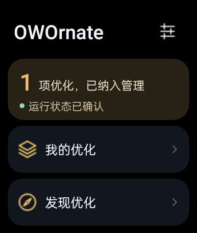
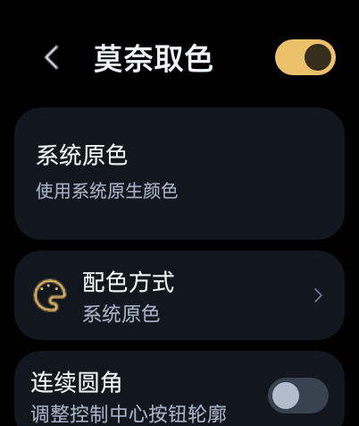
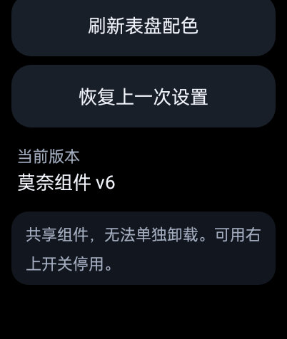
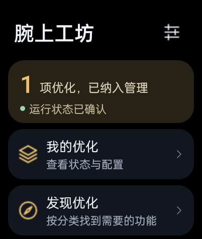
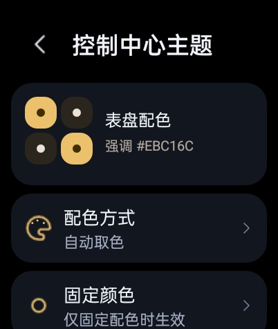
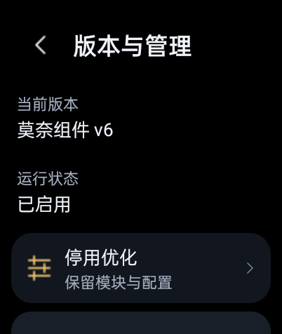

# OWOrnate 1.0.1-rc27 / versionCode 36 · 验证记录

本版统一管理器界面，精简主页与导航文案，发现页在同一界面按“未安装／已安装”分组，本地插件位于已安装首位。已安装条目显示实际版本；小组件设置、课表与录屏画质页使用统一样式。实际负一屏小组件的布局与配色保持。

2026-10-25，在 OW20W1 / A.92 / API27 / 已有 root 的原无线生产表上，同签覆盖安装最终 code36，安装后 APK 摘要与本地一致。主要页面有真实截图，标准字体下录屏画质、更多说明和主操作首屏完整；125% 字体下模块标题与开关不重叠。构建、原签名、非 debuggable 和四项许可资产检查通过；14 项 assets 与 9 项编译后 widget 资源相对 code35 原字节不变。16 项收尾检查通过，插件文件、五组用户设置、共享组件、Launcher PID 与 boot 保留；临时字体和熄屏恢复，最后休眠，未重载或重启。

手动倒计时滚轮、所有子页面／字号、实际录制及配置写入没有全量验收。code32 的公网系统安装器主链作为历史沿用，不能当作 code36 再次在线升级通过；授权 catch/fallback 的直接触发、其他硬件／固件和长期功耗仍待验证。

APK SHA-256 `b54aa93e9b6aa337ff8121f171f04eb76dbd74a1bdeccb6da7ae083f925be317`。UI 实拍见 README；历史通过项按未变更的代码与前提沿用。

# 历史：OWOrnate 1.0.1-rc23 / versionCode 32 · 验证记录

## code32 已公开：公网更新主链与恢复通过，catch 分支待触发

2026-10-24 的 A.92 设备检查确认：普通应用直接启动 `MANAGE_UNKNOWN_APP_SOURCES` 时，系统组件 `Settings$ManageAppExternalSourcesActivity` 未导出，无法正常打开。标准 `ACTION_APPLICATION_DETAILS_SETTINGS` 实际可进入 `SingleAppManagerActivity`，其中可见“允许来自此来源的应用”开关。

主代理已在 `UpdateActivity` 增加窄回退：只在启动授权页遇到 `ActivityNotFoundException` 或 `SecurityException` 时打开标准应用信息页，并显示明确操作说明。其他异常仍按原错误路径处理。用户必须手动开启开关，返回后再次确认安装，并由系统安装器完成最终确认；应用不会自动授予权限或静默安装。

2026-10-25，rc23 / code32 已公开，发布时 `main` 与 tag 指向 `440f6d4165d3671fd29a88be8a15f7fef27a3d35`。九个线上附件的大小、摘要和匿名公网下载 SHA-256 均通过。设备在 code31 上从公网发现 code32，由应用下载并核对包名、版本、签名和 SHA-256；用户点击确认安装，再由 `HeytapPackageInstallerActivity` 点击安装，安装后 current APK 摘要确认是 code32。该结果不是 `adb install`。

手表 API 可达，但 `github.com` 附件直连超时；本轮临时借用已有 PC 代理完成下载，电脑代理、TUN 和 firewall 未修改。捕获插件也从 1.0.0 经公网发现并下载 1.1.0，进入预览并点击“信任并升级”；原导入 `plugin.json`/`hook.js` 字节、原录屏画质和运行 Hook 均保持不变。

收尾执行 17 项恢复检查并全部通过：管理器原 `files` 与 `shared_prefs` 完全恢复且无新增文件；保护组件与 keys、Launcher 偏好/PID/boot、主题及 previous、无自有 runtime、capture idle 均符合原快照；5 个代理相关键与全局 unknown sources 恢复原 null，安装来源 AppOp 恢复 default；原 10 秒熄屏、31 表盘、10 个复杂功能、5 张卡片、41 项应用顺序一致，最终为 Asleep。

code32 APK 为 341,073 bytes，SHA-256 `cc9126262425a90e9861667e24d0cf2ecd66abc494f197948e7d638f42a5a8fd`；原证书、非 debuggable 与许可资产检查通过，14 个 APK assets 与 code31 相同。新增 catch/fallback 分支仍不能记为实机通过：两次安装均在普通应用信息页已经手动授权后完成。

| 验证 | 当前结果 | 范围 |
| --- | --- | --- |
| A.92 直接授权入口 | 受阻 | `ManageAppExternalSourcesActivity` 未导出，普通应用不能正常启动 |
| 标准应用信息页目标路径 | 通过 | `APPLICATION_DETAILS_SETTINGS` 可进入 `SingleAppManagerActivity`，用户手动开启来源开关 |
| code32 catch/fallback 实际触发 | 待验收 | 两次安装前均已完成手动授权，未触发新 catch 分支 |
| code31 → code32 公网更新 | 通过 | 发现、下载、包名/版本/签名/hash、确认安装及系统安装器 UI 全链通过 |
| 安装后 APK 身份 | 通过 | current 摘要为 `cc9126262425a90e9861667e24d0cf2ecd66abc494f197948e7d638f42a5a8fd`；非 ADB 安装 |
| capture 1.0.0 → 公网 1.1.0 | 通过 | 下载预览与“信任并升级”完成；原导入字节、画质及运行 Hook 不变 |
| 发布附件 | 通过 | 九附件线上大小/digest 与匿名公网 SHA-256 核对通过 |
| 17 项恢复检查 | 全部通过 | 原管理器、保护组件、Launcher、主题、设置、无自有 runtime、capture idle、表盘/复杂功能/卡片/应用顺序与 Asleep |

# 历史：OWOrnate 1.0.1-rc22 / versionCode 31 · 验证记录

## 历史：code31 候选与实机补充验收（已公开发布）

2026-10-24，code31 修复 AdbClient 丢弃无行尾换行 JSON 的问题。6 项真实解码回归通过；完整构建、原证书、非调试和许可资产检查通过，14 个 APK assets 与 code30 逐字节一致。该版本 APK 为 341,073 bytes，SHA-256 `a8f52477c9284750cacdf25496e88eebf54f2efbc4043b09883c4e161ba1c790`，已于 [v1.0.1-rc22](https://github.com/AUTOlightup/owornate/releases/tag/v1.0.1-rc22) 公开。

| 验证 | 结果 | 范围 |
| --- | --- | --- |
| AdbClient 输出解码 | 6 项通过 | 保留退出标记前的完整输出，覆盖无行尾换行的 JSON |
| 第三方卸载、重新信任导入、重装 | 通过 | 当前 Launcher PID、marker、真实映射、单 supervisor 与启用页头一致 |
| 初始化错误与恢复 | 通过 | 页面显示插件 ID 和异常，源码/包保留；右上开关停用并卸载后恢复健康 |
| v4 真实重启 | 通过 | 首次打开管理器前取得新 bootId 对应 `bootReady=true`、运行状态及启停掩码 |
| 共享环境限制 | 通过 | 第三方显示未部署、开关禁用；共享组件不被替换 |
| 共享环境卸载模块界面 | 通过 | 信任导入测试包 → 限制页开关禁用 → 卸载模块 → 确认 → 返回三个官方列表 |
| 测试后恢复 | 通过 | 原插件仓库、共享组件与 ADB keys 字节、Launcher 偏好、当次 PID、bootId、主题和 capture idle 不变；恢复原偏好与 10 秒熄屏，删除测试下载，最终休眠 |

共享环境卸载检查没有安装、重载或重启。code30 已验证的 v3→v4 迁移、第三方升级、无 trace 常亮效果及其他本机检查沿用有效证据；code31 全部运行 assets 未改。rc22 发布时 `main` 与 tag 指向 `8fed5d49e5de04a61f08163b06428965c9874ae1`，九个附件已完成匿名公网下载及 SHA-256 核对。

code31 / rc22 未覆盖旧 v2 真实迁移、其他硬件/固件、该版实际录制、QQ 送达和长期功耗。rc22 的九附件已公开；后续先在 code30 上通过代理下载 code31 并由系统安装器完成覆盖，再于 2026-10-25 从 code31 公网更新到 code32。rc23 的已发布九附件保持原字节，tag 不随文档同步移动；发布归档内的文档是发布前快照。

# 历史：OWOrnate 1.0.1-rc21 / versionCode 30 · 验证记录

## 历史：code30 本机构建阶段

第三方 launcher-v1 接入、统一页头/开关、v4 动态组合和已知 v3 迁移已实现。本轮没有连接或操作手表；共享 WatchHide 环境仍不部署第三方 Hook。进程内插件无沙箱，未开放第三方原生设置页 SDK。

| 验证 | 本轮结果 |
| --- | --- |
| 生产清单/ZIP/升级仓库 | 22组，250检查 |
| Launcher 管理适配与实际示例包 | 9组，90检查 |
| 捕获声明/莫奈声明/升级回归 | 9/86、7/138、6/69 |
| 运行核心与第三方注册 | 18组 |
| 启动固定命令 | 9场景，含仅第三方启用/停用 |
| 桌面 Setup/VerifyBoot/RemoveManager FakeADB | 18场景 |
| 生命周期 guards/orders/lifecycle/wrappers | 61/504/566/81 检查 |
| 生命周期 thirdparty/v3migration/idconflict | 193/71/32 检查 |
| 创建/打包工具、常亮 Hook 窄 mock | 通过 |
| APK 构建、证书、不可调试、许可资产 | 通过 |
| APK 运行脚本/源码、旧 v3 pins、官方载荷原字节 | 一致 |

APK：`OWOrnate-v1.0.1-rc21-code30-dev.apk`，341,073 bytes，SHA256 `afaca1b26a74471e54dc41592dc9de06313185df4d8f7713ec700ae191e75fe4`。证书 SHA256 `8a130f420724b4c72500f1b40a0aa94a304f6045fb124915aee65d5f2a1e15cd`；minSDK26/targetSDK27、versionCode30、versionName1.0.1-rc21。有效的桌面调试常亮示例为 `launcher-keep-awake-1.0.1.owo`，1,075 bytes，SHA256 `2bc15fc7f05627cd00ae17a4c51235d8747844350c6cd9704234555cccec0180`；1.0.0 示例保留为历史失败记录，不再推荐。

历史待实机项：code30 同签覆盖后的界面/导入行为；经另行安排的自有 v4 生命周期、v3 迁移、真实 Frida/窗口效果与重启恢复。上述项目后续已在 code31 实机补齐，见本文首部；code29 实测仍不替代本版。

## 历史：code29 及更早

# OWOrnate 1.0.1-rc20 / versionCode 29 · 验证记录

## 2026-10-24 补充：临时独立环境实机验收

code29 / 1.0.1-rc20 在已授权的 OPPO Watch 2 / OW20W1 / A.92 / API27 / root 生产表临时隔离环境完成：Windows包Setup及新应用密钥/nonce认证；三个官方包信任导入；捕获→小组件→莫奈首次安装；三个右上开关分别停用/启用；真实主题配置回执和画质保存；逐项卸载、最后一项卸载后保留底座且无运行注入；重新导入并按莫奈→小组件→捕获重装，画质保留。

真实重启后未打开管理器、未从电脑手动ensure，当前bootId/bootReady=true、当前Launcher PID、三个启用掩码及runtime_live=yes同时确认。电脑保留ADB取证，不声称物理断开。测试后原生产共享环境、原管理器数据/插件/密钥、主题/撤销记录、系统设置及表盘卡片恢复并核对；一次性隔离例外结束。

这补齐了同一硬件上的独立Setup、自有v3安装/启停/卸载/重装和开机恢复证据。已有root与Launcher数据保留，不等同于另一台全新设备；旧v2迁移、更多固件、实际录制、QQ送达/长期功耗和公网系统安装器仍未覆盖。旧发布附件中的文档仍为补验前快照。

以下为补验前记录，原“独立环境未验收”以本节为准。

**2026-10-24 当时候选：code29 / 1.0.1-rc20 已从 code27 同签覆盖安装，莫奈/捕获 1.1.0 声明式设置与原数据保留已实机通过，当时尚未公开发布。** 该节的未验收描述按 code29 时点理解。code27 及更早记录也属于历史，不能替代当前 code31 结论。

## code29 构建与候选

候选 APK 为 `OWOrnate-v1.0.1-rc20-code29-dev.apk` 的既有构建，发布流程只按版本名复用原字节，不重新构建或签名。APK 为 336,977 bytes，SHA-256 `5ebe91cfd4f0d06986131f93193ae685b3894f4e2d2488a957db0ba30723947c`；沿用证书 SHA-256 `8a130f420724b4c72500f1b40a0aa94a304f6045fb124915aee65d5f2a1e15cd`。原构建通过 v2/v3 签名、非 debuggable 和许可资产核对，设备安装摘要与候选一致。

候选插件为莫奈 `1.1.0 / versionCode 2`、捕获 `1.1.0 / versionCode 2` 和未改的小组件 `1.0.0 / versionCode 1`。莫奈与捕获只更新 `plugin.json` 声明；现有 Hook、helper v6 `theme.jar` 与采集载荷保持原字节。

## code29 本机验证

| 项目 | 结果 | 范围 |
| --- | --- | --- |
| 仓库与清单 | 21 组 / 240 项通过 | 插件清单、导入、注册表、配置和升级策略 |
| 插件升级调用链 | 6 组 / 69 项通过 | 升级前停用、配置/旧默认值保留、失败恢复 |
| 原 Launcher 适配 | 7 组 / 71 项通过 | 三个固定 launcher-v1 角色与既有管理契约 |
| 捕获原生设置 | 9 组 / 86 项通过 | 严格声明、旧包回退、真实值读写、失败回读 |
| 莫奈声明式设置 | 7 组 / 138 项通过 | 三值与圆角声明、单字段修改、不可用门禁、回执和保存失败 |
| APK 身份与载荷 | 通过 | 原签名、v2/v3、非调试、许可资产；莫奈 Hook/theme.jar 未变 |
| Windows 符号链接 | 跳过 | 本机权限不允许创建测试符号链接，不声称通过 |

测试使用本机 Java、fake Android 通道和主题/模块状态替身，不连接手表。桌面替身不能替代真实 ThemeRuntime、Launcher、触控或录制行为；APK 和设备结果另行记录。

## code29 手表实机

测试目标为 OPPO Watch 2 / OW20W1 / A.92 / API27 / armeabi-v7a / root，装前为 code27。完成状态与数据备份后，以同签覆盖安装 code29；设备 APK 摘要与候选一致，应用自身 nonce/root 认证通过，原管理器与 Launcher 数据保留。

* 莫奈与捕获均通过应用 Download 入口及“信任并升级”从 1.0.0 升到 1.1.0，没有直接写注册目录。莫奈导入不改变实际主题，捕获导入保留原 2.4 Mbps 选择。
* 莫奈统一页选择固定颜色后，原主题页读回对应值；原主题页切换系统原色后，统一页正确读回；统一页关闭圆角后，原主题页显示关闭且实际按钮形状同步变化；原主题页重新开启后，统一页读到新值。逐次核对 helper 主题、请求/回执、session、当前 Launcher 与成功状态。最终恢复 auto / `#F0BD50` / corners=true，并恢复装前撤销记录原字节。
* 捕获统一页改低画质后，原录屏页显示 0.6 Mbps；原页改标准后，统一页对应选中；统一页恢复高画质后，重新打开原页显示 2.4 Mbps。`capture_options.xml` 最终逐键一致，捕获会话全程 idle，未启动录制。
* 实际圆屏画面与 UI 树确认莫奈统一页右上开关、配色/圆角选项、原主题页开关和录屏页三档选择正常；共享组件管理限制保持原样。
* 最终 10 份原管理器偏好中 7 份逐键相同，另外 3 份仅变化读取/观察时间；31 个表盘、10 项 complications、5 张原生卡片和 41 项应用顺序逐项一致。插件目录只有两个 `plugin.json` 变化，Hook、`theme.jar`、示例配置和共享组件保持原字节。
* 收尾恢复熄屏 10000ms、`stay_on_while_plugged_in=0`、亮度与勿扰等原设置，清理临时文件，返回表盘并确认 Asleep。共享 Hook/helper、QQ 两个 JAR、系统白名单摘要均不变，没有创建自有 runtime。

## code29 未覆盖

* 完整 Windows Setup 全新安装、自有 v3 全新部署/迁移/启停/卸载/重装和整机重启恢复仍未实机验收；没有清除生产共享组件模拟新用户。
* 实际录制、QQ 推送、长期功耗和更多固件/API 版本没有由本轮重测；捕获画质往返只验证设置状态，捕获保持 idle。
* 真实“公网附件下载 → 系统安装器覆盖”未走通；code29 本轮也没有把候选上传为在线清单。`adb install -r` 不能替代应用自更新验收。

---
# 历史：OWOrnate 1.0.1-rc18 / versionCode 27 · 验证记录

## code27 构建与候选

公开 APK 复用已装表原字节，仅改名为 `OWOrnate-v1.0.1-rc18.apk`：332,881 bytes，SHA-256 `92bdaabad7da26331c09a13d680202c3d8154f259113d7d25bf435259b77ff79`。沿用证书 SHA-256 `8a130f420724b4c72500f1b40a0aa94a304f6045fb124915aee65d5f2a1e15cd`，非 debuggable；设备安装摘要与本机候选一致。

本次公开发布候选包含管理器 APK、Windows 包、管理器源码包、莫奈 helper 源码包、三个 `.owo`、`owornate-updates.json` 和 `SHA256SUMS.txt`。以下设备与测试证据针对管理器 APK、插件协议与手表行为；Windows/源码归档的完整性由发布目录的 `SHA256SUMS.txt` 核对，不把打包成功当作设备验收。

## code27 本机验证

| 项目 | 结果 | 范围 |
| --- | --- | --- |
| 仓库与清单 | 21 组 / 240 断言 | 插件清单、导入、注册表、配置和升级策略 |
| 实际导入到执行调用链 | 6 组 / 69 断言 | ExternalPlugins → PluginRunner → PluginRepository；最终修正后复跑 |
| 原 Launcher 适配 | 7 组 / 71 断言 | 三个 launcher-v1 角色与既有管理契约 |
| 更新客户端 | 6 组 / 100 断言 | 清单选择、HTTPS、下载、摘要、版本与错误分支 |
| APK 更新身份策略 | 10 项 | 包名、更高版本、签名集合和安装文件 URI |
| 清单与真实产物 | 4 个文件逐字节一致 | 实际生成清单由生产 `UpdateClient` 解析，并以下载替身核对 |
| shell-v1 回归 | 8 组通过 | 在最终仅配置补值/活动事务修正前通过；修正后的调用链测试通过 |
| Windows 符号链接 | 跳过 | 本机权限不允许创建测试符号链接，不声称通过 |

这些检查使用本机 Java、fake Android 命令或下载替身，不连接手表；分组含共用前置检查，不能相加成无重复总数。Android TLS、圆屏更新 UI、未知来源设置和系统安装器实际结果须另记设备证据。

## code27 手表实机

目标为测试用 OPPO Watch 2 / OW20W1 / A.92 / API27 / armeabi-v7a / root。装前为 code26，已捕获 idle，并保存管理器偏好、`files/plugins`、Launcher 偏好/数据库和已装 APK；随后以 `adb install -r` 同签安装 code27，设备摘要与候选一致。

- 设置入口进入“管理器更新”显示 1.0.1-rc18 (27)。应用内真实访问 GitHub API 成功，当前公开旧 Release 没有 `owornate-updates.json`，页面显示“尚未发布更新清单”；插件管理页的检查入口显示对应插件版本并得到相同明确结果。没有把缺清单报成最新版。
- 通过 Download 导入临时停用的熄屏示例 v1，再导入同 ID v2 并确认“信任并升级”。实际版本变为 1.0.1 / code2，仍停用；原 `config.json` 的 `timeout=60000` 字节保持，系统临时熄屏 600000 未被插件改变。
- 再导入状态返回无效的 v3。页面显示“插件没有返回有效状态”，仓库实际恢复 v2；v2 的 `plugin.json`/`plugin.sh` 摘要与升级前一致，原配置完整保留。测试未启用脚本，未改原生功能载荷。
- 通过应用卸载临时示例，删除本轮三个 Download 测试包。最终 `files/plugins` 的全部 8 个原文件逐字节一致：三个正式 Launcher 包和已有示例配置均保留，无临时测试包残留。
- 应用自身 nonce/root 回环成功，三模块本轮均为 shared 且空错误。共享 Hook/helper、QQ 两个 JAR 和系统白名单摘要不变；主题 auto / `#F0BD50` / corners=true，helper v6 ready。31 个表盘、10 个 complications、5 张原生卡片、41 项应用顺序逐项一致；10 份原偏好中 7 份逐键相同，其余仅周年读取时间、runtime 时间和模块观察记录变化。
- 收尾恢复熄屏 10000ms、亮度、勿扰、隐藏小布、捕获开关及无障碍设置；捕获保持 idle。本轮没有重载 Launcher 或重启，Launcher PID 与 bootId 保持；最后返回表盘并发送休眠指令。

## code27 未覆盖

- 公开源没有更新清单，真实“公网附件下载 → 系统安装器覆盖”未走通；`adb install -r` 不能替代应用自更新验收。
- 完整 Windows Setup 全新环境安装、自有 v3 全新部署/迁移/停用/卸载/重装、整机重启恢复仍未实机验收；没有清除生产共享组件模拟新用户。
- 真实录屏、QQ 推送、长期功耗及更多固件/API 版本未由本轮重测。

---
# 历史：OWOrnate 1.0.1-rc16 / versionCode 25 · 验证记录

2026-10-21：code25 已完成本机构建和原生产表共享环境的同签覆盖安装，尚未公开发布。当时安装 APK 为 349398 bytes，SHA256 `5ff63017e66cdd76410b4bec4af617dd23f23f4517009ffb8a3acd46b978526c`；签名沿用原证书，非 debuggable，已安装 APK 与本机候选一致。

## code25 本机验证

| 项目 | 结果 | 范围 |
| --- | --- | --- |
| 启动记录与持久化 | 12场景通过 | RuntimeSupport真实Java入口；覆盖服务存在但未就绪、旧记录、失败和手动恢复 |
| 固定启动命令 | 7场景通过 | 从Java源码提取实际命令，模拟立即/延迟就绪、超时、旧独立、共享、停用及启动失败 |
| 自有生命周期和旧v2升级 | 382/382 | 模拟Android；已知旧配对更新、各功能启停保留，未知/混合配对拒绝 |
| 状态存储 | 18/18 | Java状态投影和已有缓存兼容 |
| 桌面Setup | 12场景通过 | fake ADB，包含nonce、端口切换、移除保护、VerifyBoot及PS5/PS7解析 |
| APK | 构建、同签、非调试、载荷一致 | 不等于自有组件实机验收 |

各组有共用前置检查，不相加为无重复总数。未改动的安装顺序384项、入口转发74项、运行Hook7组、controls11项、indicator3组、共享小组件162项和信息卡14项沿用code24对应证据，未为code25重复全套。当时 code25 Windows 包及源码归档尚未重新生成，不把code24的打包结果写成code25打包通过。

## code25 共享环境实机

目标为OPPO Watch 2 / OW20W1 / A.92 / API27 / armv7，已有root adbd及共享Hook。此次仅同签覆盖APK，没有运行完整Windows Setup、清数据、替换Hook、重载Launcher或整机重启。

- 应用自身通过匹配本次nonce的root回环认证；三个模块均新读取为shared、error为空。
- 管理器首页及焦点正常；两页控制中心实际显示正常，莫奈auto、连续圆角、helper v6 ready且无错误，登记16个按钮。
- 共享环境启动记录正确显示“当前无需恢复独立组件”，不冒充自有组件启动已确认。
- 倒计时、课表、主题、画质等7份管理器用户偏好逐键不变；31个表盘、10个complications、5个原生卡片和41个应用顺序逐项一致。四项小组件绑定仍存在，ID由系统重新分配，不能假定ID不变。
- 共享Hook v13、helper v6、QQ两个组件及系统白名单摘要不变；设置未改，装前管理器和Launcher数据分别备份。本轮未重测录屏采集、QQ推送或长期表现。

## code24 / code23 已完成范围

code24共享环境已验证管理器打开原生卡片编辑页、莫奈真实停用/启用、捕获模块隐藏/恢复入口、实际PNG及MediaStore入库、重新接入后表盘重载并返回管理器。录屏因当时媒体分区仅约11 MiB而被空间检查拒绝；没有绕过保护或清理用户文件。code24的装前tar仅包含Launcher偏好和数据库，缺少管理器偏好，不能据此声称管理器偏好首后比较；code25已改为两份独立备份并确认管理器workshop.xml存在。

code23修复控制中心按钮的主题重新绑定：按实际主题DexClassLoader定位helper，不再依赖已有着色图标；两页主题和关闭重开检查通过。共享v13与helper v6在code24、code25均保持相同载荷。

## 当时的未完成项

没有备用测试表，全新环境的完整Windows Setup、表端自有三功能安装/停用/卸载/重装仍未实机验收；未清除生产共享组件模拟新用户。旧独立迁移、自有旧v2更新、启动就绪及整机重启恢复目前只有相关本机证据。RemoveManager真实往返、长期功耗和MCU/轻智能也未验收。已有共享环境覆盖安装不能替代这些结论。详见 [验收范围](ACCEPTANCE.md)。

---
# 历史：OWOrnate 1.0.1-rc10 / versionCode 19 · 源码阶段

2026-10-19 新增原生表盘录屏指示器和截图提速。按用户最新要求不构建 APK、不装表、不部署 Hook；以下 code18 及更早实机记录不能作为新行为验收。控制中心桥接 7/7、指示器生命周期/状态 3/3 组通过，属于窄桥接模拟，不覆盖真实 Frida 类注册、Android 窗口退出、图标样式或速度。

接入与生命周期脚本模拟分别132/132、93/93通过，使用上一版v13载荷摘要3aa753...；最终只将布局复制构造器改为显式Frida重载并同步摘要，脚本操作逻辑未变。最终pin、源/asset镜像及脚本语法已定向检查，未因仅更新pin重复整套模拟。已发布v11/v12、helper和capture.sh字节不变。Java截图修改在暂缓指令前做过源码编译检查；最后队列简化和模块页收尾未编译。

待后续统一构建后确认：两种截图入口捕获时不残留面板/设置页；图标与 QQ、原生提示并列且正常继承动画；真实开始/停止及自动结束同步显隐；Launcher 重建、模块停用和录制异常后的状态纠正。

## code18 / 1.0.1-rc9 · 已安装版本的验证

2026-10-19 完成构建、原表同签覆盖安装及本轮定向实测。APK `OWOrnate-v1.0.1-rc9.apk`：295,828 bytes，SHA256 `8409dc95a72a274e35aeff119e6b6d5c4e9e803d24493b3e5ab7c010738b0367`，证书仍为 `8a130f420724b4c72500f1b40a0aa94a304f6045fb124915aee65d5f2a1e15cd`，v2/v3签名且不可调试。已安装APK摘要与交付件一致，原倒计时和课表配置与升级前逐字节相同。

## 本版已验证

- OPPO Watch 2 46mm / OW20W1 / A.92 / API27：三档画质、更多说明和开始按钮完整出现在402×476首屏；开始按钮固定底部，不需要滚动。画质选择退出后保留，更多说明与返回正常。
- 退出设置后开始，从表盘采集；录制中打开设置不触发启停，短按录屏入口可正常停止。结束后前台服务及亮屏锁释放，未见本轮崩溃或ANR。
- PNG进入 `Pictures/Screenshots`，MP4进入 `Movies/Screenrecords`；两者均通过系统媒体库精确路径查询确认入库。旧文件未由版本升级迁移。
- 19.03秒、402×476 H.264 MP4样本全量解码通过，首帧是表盘。静态画面使用可变帧率，不能按屏幕刷新率宣称固定60fps。
- 原生捕获shell模拟14/14、控制中心桥接6/6、完整Java/资源/Manifest/DEX构建、签名、非调试与载荷一致性检查通过。
- 共享Hook v12保持 `4bc93055211b1c070155b45808955b6e41380c51edc63010ba8f0f759c508ac0`，helper v6保持 `706205ab96a67bfca062bca5152f89fe7cfaddc5ed9db2fe121d1697723dca74`。本版capture.sh为 `ae86fb29bb33d5d42e8d4a593e50deb20b2c9a9ed9d12fbd13b9c34c00ee8e0c`。

本次GitHub发布沿用已装表APK，没有重新编译、签名、运行应用测试或操作设备。源码与安装包核对不替代实机验收。

## 证据边界

code17验证过的180秒自动结束、模块启停与其余状态/小组件/生命周期测试属于历史记录，本版未整体重跑。三档码率与高运动画面对比、第三方应用完整动线、旧小组件完整交互、长期功耗、锁屏/MCU/轻智能和整机重启恢复仍待验收。当前为预发布，见 [ACCEPTANCE.md](ACCEPTANCE.md)。

---
# 历史：OWOrnate 1.0.1-rc8 / versionCode 17 · 验证状态

2026-10-18 完成完整构建与原表实机验证，2026-10-19 作为预发布提供。APK `OWOrnate-v1.0.1-rc8.apk`：295,828 bytes，SHA256 `a2ed3957d5a384dbde7ebfa8c391f1216140788766039705360194da884c2d2f`。沿用原签名，证书 SHA256 `8a130f420724b4c72500f1b40a0aa94a304f6045fb124915aee65d5f2a1e15cd`，v2/v3 签名且不可调试。同签覆盖安装到 OPPO Watch 2 46mm / OW20W1 / A.92 / API27，保留原应用、课表及倒计时数据。

## code17 已验证

- 共享 Hook v12 与 APK 载荷一致：`4bc93055211b1c070155b45808955b6e41380c51edc63010ba8f0f759c508ac0`；helper v6 仍为 `706205ab96a67bfca062bca5152f89fe7cfaddc5ed9db2fe121d1697723dca74`，原 v11 字节保留。
- 首页显示三个模块，小组件宿主仍有原来的五张卡片；捕获模块启停状态回读一致，按钮随开关隐藏或显示，启停不重载 Launcher。
- 控制中心第二页两个按钮及莫奈外观正常；长按分别打开 OWOrnate 截屏页与录屏设置页，录制中长按不启停当前片段。
- 截屏收起控制中心后保存 402×476 PNG；录屏从设置页返回表盘后开始，红色停止图标正常，再次短按可停止。
- 手动片段 52.39 秒、402×476、H.264 MP4、281 帧全量解码通过，开头是表盘。180 秒墙钟到时自动停止并保存，服务、通知和亮屏锁均释放。静止表盘到时样本仅 13 帧、播放时长约 130.91 秒，不能把墙钟录制时长等同于 MP4 播放时长，也不保证稳定 60fps。
- 实机发现并修复 ContentObserver 包名、A.92 无 awk、后台 Launcher 的 HOME 重建、前台服务复用与停止收尾、Frida density 字段取值；最终片段与启停验证覆盖修复后的 APK。

## 离线与构建证据

| 检查 | 结果 | 范围 |
| --- | --- | --- |
| RuntimeStateStore | 17/17 | 状态确认值、时间、错误与缓存边界 |
| 信息卡快照 | 13/13 | 共用状态快照 |
| 原生捕获 shell | 14/14 | 模拟环境：参数、空间、启停、会话与竞态 |
| 控制中心桥接 | 6/6 | 长按分发、面板收起、超时与 UI 线程边界 |
| 小组件管理 shell | 97/97 | 模拟环境：识别、接入、白名单与 Launcher 重建 |
| 模块生命周期 shell | 85/85 | 模拟环境：共享与独立生命周期 |
| 完整 APK 构建 | 通过 | Java、资源、Manifest、DEX、签名、非调试与载荷一致性 |

本次 GitHub 发布沿用上述已装表 APK，未重新编译或签名，也未再次操作设备。发布包摘要核对不替代应用实测。

## 待验收范围

第三方应用采集动线；三档画质、高运动画面的实际帧率；长期功耗与发热；息屏、锁屏、MCU/轻智能；整机重启后的完整恢复。纪念日模式、三类旧卡片的完整交互未由本轮逐项重测。此前用户确认的隐藏小布助手与 code8/code9 等历史结果仅对应当时版本。详见 [ACCEPTANCE.md](ACCEPTANCE.md)。

---
# 历史：OWOrnate 1.0.0 / versionCode 7 · 独立实机验收记录

日期：2026-10-13 至 2026-10-14。当时工程 `dist/OWOrnate-v1.0.0.apk`（versionCode 7）SHA256：`39e96a6ac06ef7d43aae96af530edebc71478f48605e1eec10ea0f4786f5d9f5`，152,717 bytes。签名证书沿用 `8a130f420724b4c72500f1b40a0aa94a304f6045fb124915aee65d5f2a1e15cd`。

## 独立实机验收与恢复（2026-10-13 至 14）

本轮先修复独立生命周期脚本对 `/proc/<pid>/cmdline` NUL 填充的误判（`standalone/module-manage.sh` 与 `assets/monet/module-manage.sh` 的 `restart_launcher`：按空白切分后做单参数身份检查，忽略 NUL 填充），重新构建 versionCode 7；随后按用户本轮明确授权，在原 OW20W1 / A.92 / API27 / 已有 root 的表上临时隔离生产组件、只重建本包数据，形成独立环境，真机实测通过：完整 Windows 包独立 Setup、表端独立安装、配色方式/固定色/圆角实时生效、单步恢复、停用→启用、卸载→重装，以及无需电脑触发的独立开机恢复（电脑保留 ADB 取证与输入连接，未声称物理断开），首次打开 OWOrnate 之前由 APP 原生代码恢复并加载实际主题。修复后模块生命周期模拟测试 56/56 通过。

隔离只重建本包（dev.codex.watchworkshop）自己的数据，未换机、未出厂重置；验收后原表已恢复到原 code6 环境，八个原生产组件、原 APP 数据、ADB 授权与系统设置与隔离前逐一相同。该历史过程的本地证据不随公开发布包提供。

这份报告与公开材料不包含 root 私钥、ADB 公钥正文或设备序列号。

边界：验收对象是用户原表，非全新硬件；长期功耗、MCU，以及更多固件/API 仍未测。本包仍为本地 RC，未上传、未发布。用户本轮解除的隔离限制为一次性例外，已结束。

---

# 历史：OWOrnate 1.0.0 / versionCode 6 · RC1 验证记录

日期：2026-10-13。APK SHA256：`d7cf96096b72c00a14157042c55621215069da08e432d7809d24f9843d5036fe`，152,717 bytes。签名证书沿用 `8a130f420724b4c72500f1b40a0aa94a304f6045fb124915aee65d5f2a1e15cd`。

## 已验证

- 构建、签名、zipalign、非 debuggable 与四份许可资产检查通过；同签覆盖既有 code5 成功，版本显示 1.0.0/code6。安装和进入配置均未自动提交旧草稿。
- 原 OPPO Watch 2 46mm / A.92 / API27 / root adbd 共享环境：主页两栏目无子标题，无最近操作和返回表盘按钮。发现优化→商店介绍→打开配置；右滑依次返回介绍、发现、首页。从我的优化进入则返回我的优化；首页右滑退出到 Launcher。
- 配色方式、固定颜色与圆角选择直接生效；实测 fixed、雾蓝 #91BDFF、单步恢复、original、关闭圆角、重新开启圆角及 auto。不出现常规应用确认、全屏等待或成功页。
- 系统原色且关闭圆角时仍显示启用；强制停止并重新打开 APP 后该意图仍保留。右上开关完成显式停用与启用，停用时配置不可编辑，始终留在同一详情页。
- 页底展示组件 v6 与共享组件不能单独卸载的说明。标题、返回和 44dp 开关触控区在原手表尺寸下可用，稳定截图见下方。
- 源码导航方法 26/26 JVM 检查通过：两类进入来源、返回栈去重、进度页、安装/卸载结果、读取和实时写入期间的浏览。渲染及设备调用使用 stub，不等于独立安装实机验收。
- `tests/OWOrnateFlowTest.java` 的 6/6 组检查通过，直接运行真实 LatestThemeQueue 和 ModuleCatalog：只允许一条写入、等待值合并到最新、失败清空等待并在回读期间拒绝提交、显式再次提交、idle 后重启、未安装在前且组内稳定。排序使用测试数据，正式目录仍只有莫奈一项。

- 技术详情→导出当前配置成功，导出文件为真实状态快照，`deviceStateConfirmed=true`、`applied=false`；返回技术详情、关于、设置、首页正常。
- 收尾确认实际主题恢复为 auto / #F0BD50 / 强调 #EBC16C / corners=true；共享 Hook 与 helper 的 SHA256 均与测试前一致。测试用熄屏超时已恢复10000ms。

实机脚本的底部滚动距离与“关于OWOrnate”匹配文本曾导致检查中断；补正后续步骤并退出充电覆盖层后完成剩余检查。中断不作为产品失败或通过项；上面的结论均有实际回读或界面证据。

## 验证边界

原表仍使用既有综合 Hook v9 + helper v6，不隔离成空白环境。实时失败队列由离线测试验证；未在生产表人为破坏 root、断开本机协议或注入故障。旧页面恢复路径已按源码检查和导航测试覆盖，未伪造 Android savedInstanceState 作实机结论。连续快速修改的合并行为由受控并发测试验证，实机此次为顺序操作。

共享 setEnabled 增加了成功回执后的启用意图持久化，本轮实机已验证；独立生命周期脚本、HCT 和密钥实现未改，沿用已有 51/51 模拟、311/311 与 24/24 检查。51项模拟不能替代独立注入验收。

正式发布仍待空白 root 适配手表的首次部署、独立模块安装/停用/启用/卸载/重装、整机重启恢复，见 [ACCEPTANCE.md](ACCEPTANCE.md)。未做长期功耗、MCU 或全部极端字号验收，未上传 GitHub。

## 本版真实截图

   

---

# 历史：1.1.0 / versionCode 5 · RC1 验证记录

日期：2026-10-11。当前 APK SHA256：`153709b38549a27c689d4bc3423fdd1b580a7f3bc77380f364d59018d918a723`，148,621 bytes。证书沿用 `8a130f420724b4c72500f1b40a0aa94a304f6045fb124915aee65d5f2a1e15cd`。

## 本轮变更与检查

- 修复状态读取期间导航点击无响应；未知模块数显示“—”及中性状态点。保留写操作等待限制。
- 构建、签名、对齐、非 debuggable 与许可资产检查通过。版本码由4提升至5，避免将不同 APK 当成同一构建。
- 在既有 OPPO Watch 2 46mm / A.92 / API27 / root adbd 共享环境同签升级成功。冷启动后立即点击“我的优化”、配置→配色方式→返回、配置→优化管理→返回均通过；从我的优化右滑回首页后立即点击“发现优化”成功，子页右滑逐级返回，首页右滑退出到 Launcher。
- 主题与草稿前后相同：auto / #F0BD50 / 强调 #EBC16C / corners=true。未变更共享 Hook v9、helper v6。测试临时熄屏超时已恢复10000ms。
- 基于当前源码提取导航方法运行 JVM 检查，23/23通过：沿用13项导航/结果分支，新增只读刷新、主题预览时导航以及保存/执行/进度页阻止跳转。渲染、设备操作为 stub，不替代实机安装验收。

本轮截图：`screenshots/home-rc1.png`、`mine-rc1.png`、`theme-rc1.png`、`manage-rc1.png`、`discover-rc1.png`。code4 的完整页面及确认边界证据保留在下文；模块、配色算法和密钥实现未改，复用既有验证。

## 发布范围

APK、Windows 首次部署包、管理器源码与莫奈源码按同一 RC 材料重建，SHA256SUMS 随包提供。在线目录未实现；未创建或上传 GitHub Release。

正式版仍待空白 root 适配手表的首次部署、独立模块安装/卸载/重装及整机重启恢复验收，见 [ACCEPTANCE.md](ACCEPTANCE.md)。本轮共享表导航检查不覆盖这些项目。

---

# 历史：1.1.0 / code4 导航简化版验证记录

日期：2026-10-11。APP dev.codex.watchworkshop，1.1.0 / versionCode 4。下方还原版记录为历史候选。

## 当时构建

最终 APK SHA256：193c4bb2acea6bf75d556a7b3425ce61c6c715f38807902636e67fa5f53927c3，148,621 bytes。同签覆盖安装成功，非 debuggable、签名、对齐与许可资产构建检查通过。证书 SHA256：8a130f420724b4c72500f1b40a0aa94a304f6045fb124915aee65d5f2a1e15cd。

验证设备为 OPPO Watch 2 46mm / A.92 / API27 / root adbd，使用既有共享 v9 + helper v6。这是 code4 导航基线，本轮 RC 使用下述 code5 的后续构建。

## 本轮检查

1. 首轮导航构建 SHA256 8652c0172a753fee1a7a691bb4011e72395074d8b5f41770a2abde70de505dc4：实测首页、我的优化、配置、配色方式、颜色、应用确认、管理、停用/恢复确认、发现、设置、环境、关于、技术、许可、首次设置、记录的进入与右滑返回；纵向滚动与短横拖不返回；首页右滑后实际前台为 Launcher。
2. 最终构建补齐稳定的管理页配置入口、隐藏等待页无效箭头，并收敛状态恢复和停用后的返回栈。覆盖后复查首页→我的优化→配置→管理→配置、发现和设置返回、首页右滑退出。最终停在首页。
3. 提取最终源码真实 go/onBackPressed/resultDestination/finishResult/themeReachable 方法在 JVM 运行：13/13通过，覆盖栈去重、空栈子页、进度页、安装成败、应用、恢复、启停、卸载和真实停用状态优先。渲染与设备操作为 stub，不替代独立模块实机验收。
4. 切换固定模式草稿、进入颜色和应用方案、取消停用/恢复确认都没有更改实际主题；结束时实际主题与草稿均与测试前一致：auto / #F0BD50 / 强调 #EBC16C / corners=true。
5. 测试期间熄屏超时临时由10000ms延长至120000ms，完成后恢复10000ms。224→131只用于退出充电覆盖层；普通检查仅发送224，UI dump先清除旧文件。

验证依据为真实 UI 层级与屏幕截图、操作前后的主题与草稿核对，以及实际运行源码方法的离线测试。最终截图见 screenshots/*-navigation.png。原始设备日志保留在开发记录，不随公开包分发。

## 未新增验收

空白root表的独立安装、卸载、重装、整机开机恢复、长期功耗、MCU仍沿用原待验收状态。在线目录和下载未实现。调色板、密钥、模块生命周期与部署实现未改，复用既有证据。

---

# 历史：1.1.0 设计稿还原版验证记录

日期：2026-10-11。APP `dev.codex.watchworkshop`，1.1.0 / versionCode 4。

## 发布文件

- APK：148,621 bytes，SHA256 `3de2cf51646f788e042fabd29d5118480f75c61323482c3ee20ef754789a739b`。
- 延续既有签名，证书 SHA256 `8a130f420724b4c72500f1b40a0aa94a304f6045fb124915aee65d5f2a1e15cd`。
- 同签构建、签名验证、zipalign、非 debuggable 与四份许可资产检查通过。
- helper v6 未改动，指纹 `706205ab96a67bfca062bca5152f89fe7cfaddc5ed9db2fe121d1697723dca74`；综合 Hook v9 继续由原共享环境提供。

## 本轮已验证

1. 原 A.92 手表覆盖安装成功。按原稿恢复首页概览、我的优化、发现优化、外观分类、莫奈详情、主题设置、配色单选、六色选择、应用方案、操作结果、版本与管理和设备设置。
2. 草稿选择雾蓝及进入应用方案后，实际主题仍为自动取色。点击“确认应用”后，实际状态变为 fixed / #91BDFF / corners=true，回执确认成功。
3. “恢复上一次设置”经确认恢复 auto / #F0BD50 / corners=true，并核对恢复后的草稿已持久化。
4. 共享模式停用经确认后为 original / corners=false；重新启用后恢复 auto / #F0BD50 / corners=true。最后保持该状态。设置、设备、偏好和操作记录可通过页面内返回导航。
5. 最终视觉修正为页头图标增加内边距（图标 20dp、点击区 44dp），并将版本与管理页恢复为版本、状态、管理操作的原稿顺序。配色和生命周期逻辑相同，沿用上面本轮已完成的实测；最终 APK 覆盖安装后重新检查首页、主题、管理页及操作可见性，并确认没有改变实际主题。
6. 模块生命周期脚本 51/51 测试通过，覆盖首次安装、停用/启用/卸载/重装、失败清理及共享组件保护。测试使用临时目录和模拟 Android 平台命令，不代表真实独立注入或开机测试。

通过设备文档规定的 224 → 131 按键退出充电覆盖层。全程使用原共享环境，没有隔离原表或模拟拔电。字号为 100%。

## 界面截图

  

以上均为最终 APK 的真实手表截图。首页数字为真实可管理模块数 1；设计稿里的其他模块尚未发布，因此不显示对应入口。

## 沿用的验证

模块生命周期和 Windows 部署脚本本轮没有改变。之前的 Windows PowerShell 5.1 共享模式 Setup 验证仍适用于部署逻辑，本轮没有重复执行 Setup。HCT 调色板 311/311 与密钥实现 24/24 的已有测试证据保持有效。

## 未验证范围

空白 root 手表首次部署、独立模式的安装确认页到实际安装/停用/卸载/重装、整机开机恢复仍待实机验收。原表已安装共享模块，没有伪造未安装状态去获取安装页截图。

本轮没有重新测试放大字号、长期功耗、多表盘长期切换或 MCU 换色。GitHub 在线目录与下载尚未接入，当前仅支持内置莫奈的表端离线安装；尚未上传 GitHub。
